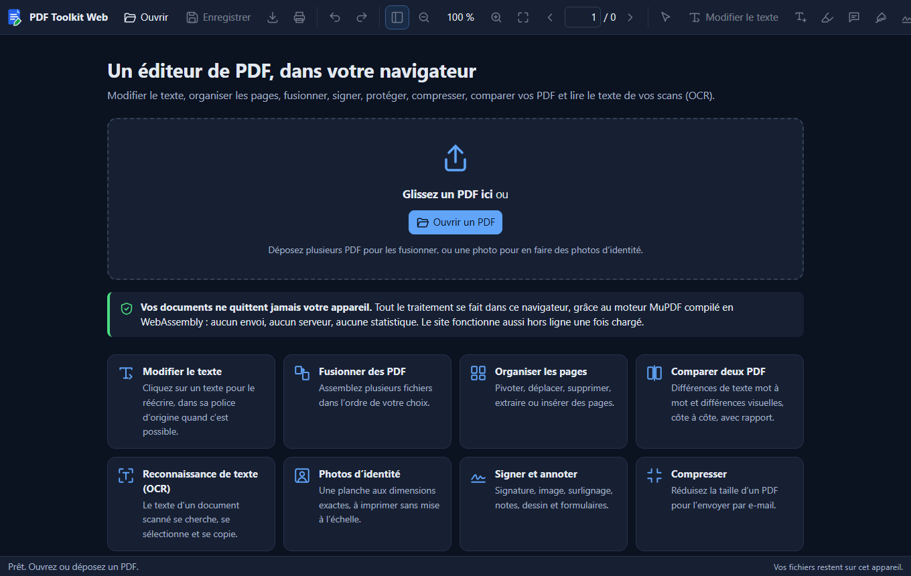
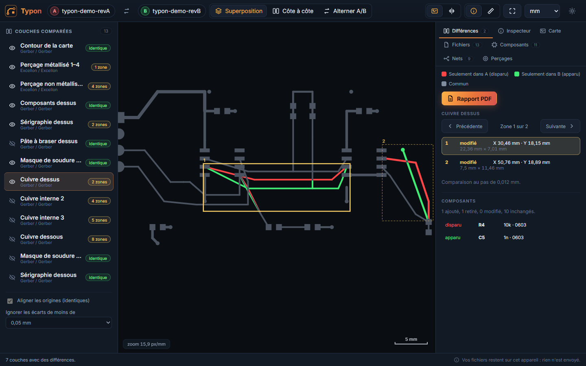
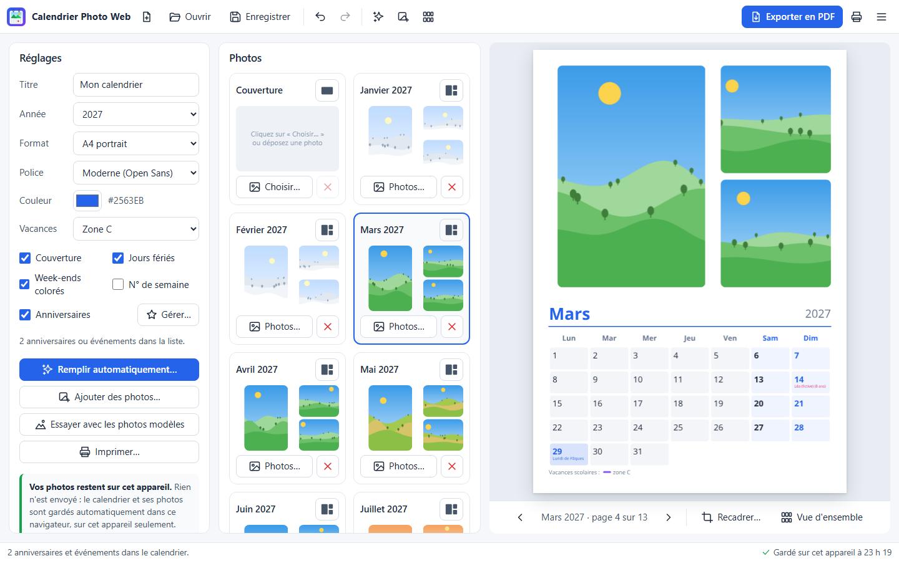
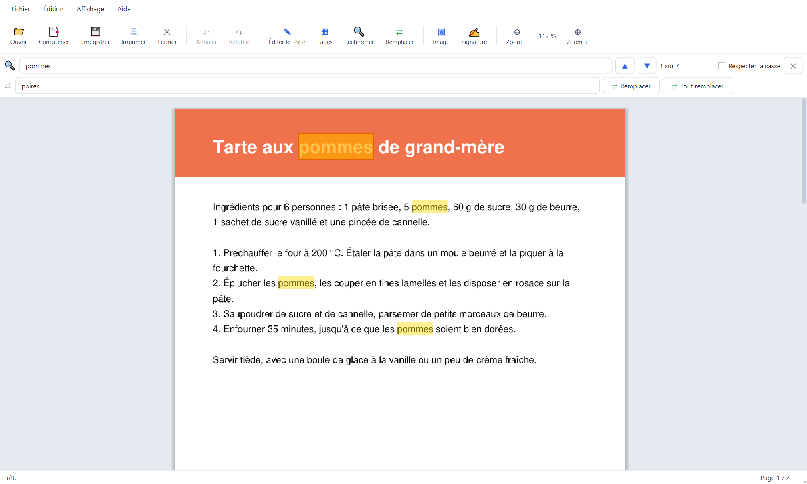
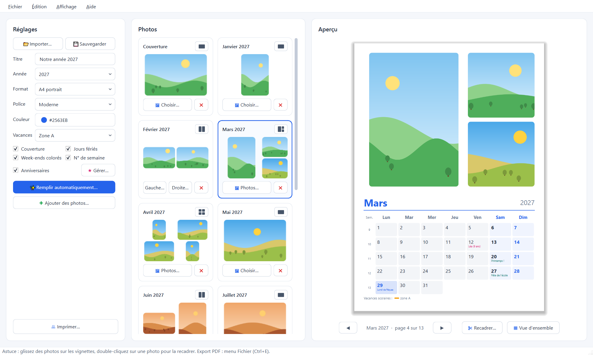

# Applications

Logiciels gratuits, en français. **Ils s'utilisent directement dans le navigateur, sans rien installer**, sur
ordinateur, tablette ou téléphone. Tout se fait sur votre appareil : vos documents, vos fichiers et vos photos ne sont
jamais envoyés sur Internet. Les sites fonctionnent aussi hors ligne une fois ouverts.

| Application | À quoi elle sert | Ouvrir |
|---|---|---|
| **PDF Toolkit Web** | Modifier, assembler, comparer, signer et protéger vos PDF ; lire le texte des scans ; photos d'identité | [Ouvrir PDF Toolkit](https://yannickbuchet-ctrl.github.io/pdf-toolkit-web/) |
| **Typon** | Voir, comparer et vérifier les fichiers de fabrication de circuits imprimés (Gerber, ODB++, IPC-2581) | [Ouvrir Typon](https://yannickbuchet-ctrl.github.io/typon/) |
| **Calendrier Photo Web** | Créer un calendrier avec vos photos, prêt à imprimer | [Ouvrir Calendrier Photo](https://yannickbuchet-ctrl.github.io/calendrier-photo-web/) |

PDF Toolkit et Calendrier Photo existent aussi en logiciels à installer sur Windows : voir
[Versions Windows](#versions-windows) à la fin de la page.

## PDF Toolkit Web

**Ouvrir : <https://yannickbuchet-ctrl.github.io/pdf-toolkit-web/>**

Un éditeur de PDF complet, dans le navigateur (Chrome, Edge, Firefox, Safari).

- **Modifier le texte** d'un PDF directement sur la page, dans sa police d'origine quand c'est possible ;
  **rechercher et remplacer** dans tout le document.
- **Assembler** plusieurs PDF ; **organiser** les pages : déplacer, faire pivoter, supprimer, extraire, insérer.
- **Annoter, signer et remplir** : surlignage, notes, dessin, signature, image, formulaires.
- **Comparer deux PDF** : différences de texte mot à mot et différences visuelles, côte à côte ou superposées, zoom
  synchronisé, rapport PDF. Un réglage « Plan technique » compare finement les plans et les circuits imprimés.
- **Lire le texte des documents scannés** (OCR) : un PDF scanné devient cherchable, et son texte se sélectionne et se
  copie, sans changer d'aspect. Français et anglais.
- **Photos d'identité** aux formats officiels, sur une planche qui s'imprime à la taille exacte. Les photos d'iPhone
  (HEIC) sont acceptées.
- **Protéger par mot de passe** et **compresser** pour l'envoi par e-mail.
- **L'installer comme une application** (facultatif) : avec Chrome ou Edge, cliquez sur l'icône « Installer » à
  droite de la barre d'adresse. PDF Toolkit apparaît alors dans le menu Démarrer et dans « Ouvrir avec » pour les PDF.

Code source : [github.com/yannickbuchet-ctrl/pdf-toolkit-web](https://github.com/yannickbuchet-ctrl/pdf-toolkit-web)
(licence GNU AGPL v3).

## Typon : fichiers de circuits imprimés

**Ouvrir : <https://yannickbuchet-ctrl.github.io/typon/>**

Pour les concepteurs électroniques : une visionneuse, un comparateur et un vérificateur de fichiers de fabrication.

- **Lit** les Gerber (RS-274D, RS-274X, X2, X3), les perçages Excellon et XNC, les fichiers de job, l'**ODB++** et
  l'**IPC-2581**, en fichiers séparés, en archive ZIP ou TGZ, ou en dossier.
- **Affiche** chaque couche (dessus, dessous, couleurs, opacité), et donne au clic l'ouverture, le net, le composant et
  la broche d'un élément ; mesure les distances.
- **Montre la carte en 3D** : plaque découpée à son épaisseur, cuivre, vernis, sérigraphie, trous et boîtiers des
  composants.
- **Vérifie la fabricabilité (DFM)** : largeur des pistes, isolements, courts-circuits, anneaux, perçages, cuivre au
  bord, vernis et sérigraphie, avec des profils de fabricants (JLCPCB, PCBWay, Eurocircuits…) et un rapport PDF.
- **Compare deux versions**, même dans des formats différents : superposition (ce qui a disparu en rouge, ce qui est
  apparu en vert), côte à côte ou en alternance, zones de différence listées, composants ajoutés ou retirés, rapport
  PDF.
- **Surligne un net** et mesure la longueur de ses pistes.
- **Met en forme l'ODB++ et l'IPC-2581** : couches, composants, nomenclature, nets et perçages en tableaux,
  exportables en CSV pour Excel.
- **Met la carte en panneau** (rainures en V ou languettes perforées, bords, mires) et l'exporte en Gerber.
- **Produit une fiche PDF** de description de la carte : vues 2D et 3D, caractéristiques, empilage, perçages,
  composants, nomenclature.
- **En français ou en anglais**, au choix. Une carte d'exemple, avec quelques défauts cachés, permet de tout essayer.

Code source : [github.com/yannickbuchet-ctrl/typon](https://github.com/yannickbuchet-ctrl/typon) (licence MIT).

## Calendrier Photo Web

**Ouvrir : <https://yannickbuchet-ctrl.github.io/calendrier-photo-web/>**

Créez un calendrier personnalisé avec vos photos, puis exportez-le en PDF prêt à imprimer.

- **Couverture et 12 mois**, au format A4 ou A3, en portrait ou en paysage ; **une à quatre photos par page**.
- **Remplissage automatique** : sélectionnez toutes vos photos d'un coup ; elles sont rangées mois par mois selon
  leur date de prise de vue, chacune dans un cadre adapté.
- **Recadrage** de chaque photo (zoom et position), ou photo entière.
- **Jours fériés** et **vacances scolaires** françaises (zones A, B et C), numéros de semaine, week-ends en couleur,
  choix de la police et des couleurs.
- **Anniversaires et événements**, avec l'âge pour les anniversaires, dans un fichier ouvrable avec Excel.
- **Le fichier de projet emporte ses photos** : un calendrier enregistré se rouvre sur n'importe quel appareil.
- Pour essayer sans vos photos : « Essayer avec les photos modèles ».

Code source : [github.com/yannickbuchet-ctrl/calendrier-photo-web](https://github.com/yannickbuchet-ctrl/calendrier-photo-web)
(licence MIT).

## Versions Windows

PDF Toolkit et Calendrier Photo existent aussi en logiciels pour Windows 10 et 11 (64 bits), qui fonctionnent sans
navigateur ni connexion.

| Logiciel | Version | Installateur | Portable |
|---|---|---|---|
| **PDF Toolkit 2** | 1.5 | [Installer](https://github.com/yannickbuchet-ctrl/applications/releases/download/pdf-toolkit-2-v1.5/PDF-Toolkit-2-Installation-1.5.exe) | [PDF Toolkit 2.exe](https://github.com/yannickbuchet-ctrl/applications/releases/download/pdf-toolkit-2-v1.5/PDF-Toolkit-2.exe) |
| **Calendrier Photo** | 1.2 | [Installer](https://github.com/yannickbuchet-ctrl/applications/releases/download/calendrier-photo-v1.2/Calendrier-Photo-Installation-1.2.exe) | [Calendrier Photo.exe](https://github.com/yannickbuchet-ctrl/applications/releases/download/calendrier-photo-v1.2/Calendrier-Photo.exe) |

Toutes les versions sont sur la page [Releases](https://github.com/yannickbuchet-ctrl/applications/releases).

### Quelle version choisir ?

- **Installateur** (recommandé) : il installe le logiciel pour vous, sans droits d'administrateur, avec un raccourci
  dans le menu Démarrer. Pour le retirer : Paramètres → Applications. C'est la version la moins souvent bloquée par
  les antivirus.
- **Portable** : un seul fichier `.exe` à lancer directement, sans rien installer. Pratique sur une clé USB.

### Au premier lancement

- Windows peut afficher « Windows a protégé votre ordinateur », car les fichiers ne sont pas signés numériquement :
  cliquez sur **Informations complémentaires**, puis sur **Exécuter quand même**.
- Si votre antivirus bloque le fichier (fausse alerte), autorisez-le ou ajoutez-le à ses exclusions.

### PDF Toolkit 2

Les mêmes outils que PDF Toolkit Web : modifier le texte (avec les informations pour retrouver une police non
installée), rechercher et remplacer, assembler et organiser, remplir les formulaires, insérer une image ou une
signature, protéger par mot de passe (AES 256 bits), compresser, lire le texte des scans (OCR, avec une fenêtre pour
chercher dans le texte reconnu), comparer deux PDF, photos d'identité, annuler et rétablir, impression.

Logiciel libre sous licence GNU AGPL v3 : code source sur
[github.com/yannickbuchet-ctrl/pdf-toolkit-2](https://github.com/yannickbuchet-ctrl/pdf-toolkit-2).

### Calendrier Photo

Les mêmes calendriers que Calendrier Photo Web : couverture et 12 mois, une à quatre photos par page, remplissage
automatique selon la date des photos, recadrage, jours fériés et vacances scolaires, anniversaires, vue d'ensemble,
sauvegarde automatique et récupération après une fermeture imprévue, export PDF en 300 dpi et impression.

## Crédits

Applications écrites par **Claude Code** sous la direction de **Yannick Buchet**.
