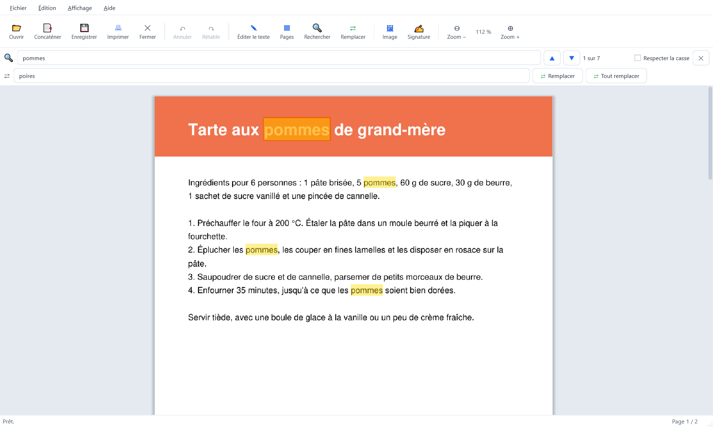

# Applications

Logiciels gratuits pour Windows 10 et 11 (64 bits), en français. Chaque application est un seul fichier `.exe` :
téléchargez-le et lancez-le, rien à installer.

| Application | Description | Téléchargement |
|---|---|---|
| **Calendrier Photo** | Calendrier personnalisé avec vos photos, exporté en PDF prêt à imprimer | [Calendrier Photo.exe](https://github.com/yannickbuchet-ctrl/applications/releases/download/calendrier-photo-v1.0/Calendrier-Photo.exe) |
| **PDF Toolkit 2** | Éditeur de PDF : texte, pages, formulaires, signatures, mots de passe, compression | [PDF Toolkit 2.exe](https://github.com/yannickbuchet-ctrl/applications/releases/download/pdf-toolkit-2-v1.0/PDF-Toolkit-2.exe) |

Toutes les versions sont sur la page [Releases](https://github.com/yannickbuchet-ctrl/applications/releases).

## Au premier lancement

- Windows peut afficher « Windows a protégé votre ordinateur », car les exécutables ne sont pas signés
  numériquement : cliquez sur **Informations complémentaires**, puis sur **Exécuter quand même**.
- Si votre antivirus bloque le fichier (fausse alerte), autorisez-le ou ajoutez-le à ses exclusions.

## Calendrier Photo

Créez un calendrier personnalisé avec vos photos, puis exportez-le en PDF prêt à imprimer.

- Couverture et 12 mois, au format A4 ou A3, en portrait ou en paysage.
- Une à quatre photos par mois, remplissage automatique par date de prise de vue, recadrage de chaque photo.
- Jours fériés et vacances scolaires françaises (zones A, B et C), numéros de semaine.
- Anniversaires et événements, avec import et export de la liste au format CSV.
- Export PDF en 300 dpi et impression.

## PDF Toolkit 2

Un éditeur de PDF simple et en français.

- Modifier le texte, rechercher et remplacer.
- Assembler plusieurs PDF, organiser, tourner et supprimer les pages.
- Remplir les formulaires, insérer des images et des signatures.
- Protéger par mot de passe (AES 256 bits) et compresser à l'enregistrement.

PDF Toolkit 2 est un logiciel libre sous licence GNU AGPL v3 : son code source est disponible sur
[github.com/yannickbuchet-ctrl/pdf-toolkit-2](https://github.com/yannickbuchet-ctrl/pdf-toolkit-2).

## Crédits

Applications écrites par **Claude Code** sous la direction de **Yannick Buchet**.
